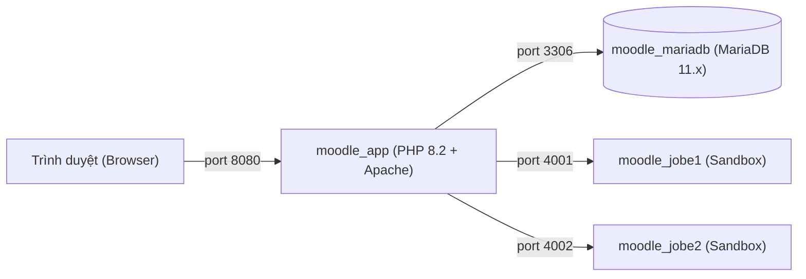

# 🚀 Hướng Dẫn Cài Đặt & Sử Dụng Moodle + CodeRunner Portable Stack

Tài liệu này hướng dẫn chi tiết cách cài đặt và vận hành hệ thống **Moodle LMS + CodeRunner + Sandbox Jobe Cluster + Module Trao đổi Testcase** trên bất kỳ máy tính nào (Windows, macOS, Linux) chỉ với **1 cú nhấp chuột**, không cần cài đặt PHP, Apache, MariaDB hay cấu hình mạng thủ công.

---

## 📋 1. Yêu Cầu Duy Nhất Trước Khi Cài

Hệ thống đã được đóng gói toàn diện thành các Docker Containers độc lập. Bạn chỉ cần:
* Cài đặt **[Docker Desktop](https://www.docker.com/products/docker-desktop/)** (khuyên dùng bản mới nhất).
* Đảm bảo Docker Desktop **đang được bật và đang chạy** (icon cá voi màu xanh sáng ở thanh taskbar/menu bar).
* Bộ nhớ trống tối thiểu: **5 GB**.
* RAM khuyến nghị: Tối thiểu **4 GB - 8 GB** cấp cho Docker.

---

## ⚡ 2. Cài Đặt Siêu Nhanh (1-Click)

Sau khi tải về và giải nén thư mục `portable_dist` (hoặc file `moodle_portable_full_package.zip`), bạn làm theo hướng dẫn dưới đây tương ứng với hệ điều hành của mình:

### 🪟 Dành cho người dùng Windows
1. Mở thư mục vừa giải nén.
2. Nhấp đúp chuột trái vào file:
   ```cmd
   run_stack.bat
   ```
3. Cửa sổ Command Prompt sẽ tự động nạp toàn bộ Docker Images và khởi chạy các dịch vụ (chỉ mất khoảng 1-2 phút trong lần chạy đầu tiên).

---

### 🍏 Dành cho người dùng macOS / 🐧 Linux
1. Mở **Terminal** và điều hướng đến thư mục vừa giải nén:
   ```bash
   cd path/to/portable_dist
   ```
2. Phân quyền và thực thi script:
   ```bash
   chmod +x run_stack.sh
   ./run_stack.sh
   ```

---

### 🛠️ Cách cài đặt thủ công (Dành cho Lập trình viên)
Nếu muốn tự chạy bằng lệnh Docker tiêu chuẩn:
```bash
# Bước 1: Nạp bộ image nén vào Docker
docker load -i moodle_stack_images.tar.gz

# Bước 2: Khởi chạy 4 containers nền
docker compose -f docker-compose.portable.yml up -d
```

---

## 🌐 3. Thông Tin Truy Cập Hệ Thống

Sau khi script báo hoàn tất, bạn có thể mở trình duyệt web và truy cập các địa chỉ sau:

| Dịch vụ | Địa chỉ URL | Tài khoản / Mật khẩu | Ghi chú |
| :--- | :--- | :--- | :--- |
| **Moodle LMS** | `http://localhost:8080` | `admin` / `AdminPassword123!` | Toàn bộ khóa học, quiz & ngân hàng đề |
| **Kho Testcase Dashboard** | `http://localhost:8080/testcase_dashboard.php` | Đăng nhập tài khoản Moodle | Quản trị và kiểm duyệt testcase sinh viên |
| **Jobe Sandbox 1** | `http://localhost:4001` | *(Không cần đăng nhập)* | Endpoint biên dịch code an toàn 1 |
| **Jobe Sandbox 2** | `http://localhost:4002` | *(Không cần đăng nhập)* | Endpoint biên dịch code an toàn 2 |
| **MariaDB Database** | `localhost:3306` | `root` / `rootpassword` | CSDL `moodle` và `testcase_store` |

> [!TIP]
> Hệ thống đã có sẵn các khóa học mẫu, ngân hàng câu hỏi lập trình CodeRunner (Python, C/C++) và các bài thi trắc nghiệm lập trình đã cấu hình sẵn quyền đóng góp testcase.

---

## ⏸️ 4. Tạm Dừng và Bật Lại Hệ Thống

* **Tạm dừng hệ thống (vẫn giữ nguyên dữ liệu đã tạo thêm):**
  ```bash
  docker compose -f docker-compose.portable.yml stop
  ```
* **Bật lại hệ thống sau khi dừng:**
  ```bash
  docker compose -f docker-compose.portable.yml start
  ```
* **Tắt hoàn toàn container (bảo toàn CSDL và file nộp bài):**
  ```bash
  docker compose -f docker-compose.portable.yml down
  ```

---

## ❓ 5. Xử Lý Các Vấn Đề Thường Gặp (Troubleshooting)

### 1. Báo lỗi `Cannot connect to the Docker daemon`
* **Nguyên nhân:** Bạn chưa mở ứng dụng Docker Desktop hoặc dịch vụ Docker Service bị treo.
* **Khắc phục:** Mở ứng dụng **Docker Desktop**, chờ icon chuyển sang trạng thái *Running* (màu xanh lá) rồi chạy lại script.

### 2. Báo lỗi xung đột cổng (`Bind for 0.0.0.0:8080 failed: port is already allocated`)
* **Nguyên nhân:** Máy tính của bạn đang có phần mềm khác dùng cổng `8080`, `3306`, `4001` hoặc `4002`.
* **Khắc phục:**
  1. Mở file `docker-compose.portable.yml` bằng Notepad/VS Code.
  2. Sửa cổng bị trùng sang cổng khác, ví dụ đổi `8080:80` thành `8088:80`.
  3. Chạy lại `./run_stack.sh` hoặc `run_stack.bat`.

### 3. Trên Windows gặp lỗi `wsl --update`
* **Nguyên nhân:** Máy Windows chưa kích hoạt hoặc chưa cập nhật WSL 2 backend cho Docker Desktop.
* **Khắc phục:** Mở PowerShell bằng quyền Admin, gõ `wsl --update`, khởi động lại máy rồi bật Docker Desktop.

---

## 🏛️ 6. Kiến Trúc Stack Hệ Thống

Hệ thống được thiết kế theo kiến trúc cô lập container tiêu chuẩn microservices:



* **Dữ liệu bền vững:** Dữ liệu CSDL và các tệp tin bài thi, nộp bài được lưu trữ trong Docker Named Volumes (`mariadb_data` và `moodledata`).
* **Bảo mật:** Sandbox Jobe chạy độc lập, ngăn chặn hoàn toàn mã độc hoặc vòng lặp vô hạn từ mã nguồn của sinh viên ảnh hưởng tới máy chủ chính.
